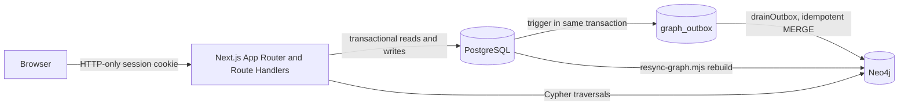

# RecallGraph project report

## 1. Title and problem statement

**RecallGraph: A multi-database failure intelligence system.** Service teams often record incidents as isolated tickets. That makes repeated symptoms, upstream causes, and likely blast radius hard to see during the next failure. RecallGraph records incidents in PostgreSQL, then projects their service, symptom, and cause links into Neo4j. Its intelligence is explainable: shared symptoms, past root-cause categories, service dependency hops, and rule-based match scores. This goes beyond CRUD because users can investigate recurrence, upstream suspects, related failures, and resolution trends.

## 2. Objectives

1. Preserve consistent incident, user, catalog, and audit facts with database constraints.
2. Expose recurring patterns and dependency paths through graph traversals.
3. Let analysts log, investigate, and resolve incidents while admins govern the catalog, users, and graph sync.
4. Make graph projection retryable after an outage and test the application against an isolated database.

## 3. Functional requirements

| Role    | Functions                                                                                                                                                                                                                             |
| ------- | ------------------------------------------------------------------------------------------------------------------------------------------------------------------------------------------------------------------------------------- |
| Analyst | Sign in; search/filter/page incidents; log with symptoms; start investigation; resolve with cause/category; inspect audit timeline, similar incidents, upstream suspects, likely causes, recurrence, co-occurrence, and blast radius. |
| Admin   | All analyst functions; reopen/delete incidents; create services, symptoms, categories, and dependencies; remove dependencies; create users/change roles; inspect all recent audit events and graph outbox state; run sync.            |

Role checks are in the Route Handlers through <code>requireUser</code>, including a current database role read. The UI hides admin controls but is not the authority.

## 4. System architecture



PostgreSQL is the source of truth. A SQL trigger queues a graph change in the same transaction as an incident or catalog write. The shared worker in <code>lib/outbox-core.mjs</code> reads pending rows with <code>FOR UPDATE SKIP LOCKED</code>, writes an idempotent graph projection, and marks the row processed. If Neo4j fails, the row keeps <code>last_error</code> and remains pending; the admin Graph Sync panel retries it. Graph results are eventually consistent. <code>scripts/resync-graph.mjs</code> can rebuild projections from SQL; its optional <code>--wipe --confirm-wipe</code> deletes all Neo4j nodes and must be used only on a dedicated graph instance.

## 5. Database choice and justification

| Data                                                                  | Database   | Reason                                                                                                                                                     |
| --------------------------------------------------------------------- | ---------- | ---------------------------------------------------------------------------------------------------------------------------------------------------------- |
| Users, roles, services, incidents, symptoms, categories, audit events | PostgreSQL | ACID transactions, foreign keys, checks, unique constraints, triggers, and durable audit history keep canonical facts consistent.                          |
| Service dependencies and incident–symptom–cause links                 | Neo4j      | Variable-length dependency paths and shared-neighbour traversals are the main investigation questions; nodes/edges directly represent those relationships. |
| Graph outbox                                                          | PostgreSQL | It must commit atomically with the source change so failed projections can be retried.                                                                     |

### Why not SQL only?

SQL can answer blast radius. The tested SQL uses a recursive CTE with a visited path to avoid cycles:

```sql
WITH RECURSIVE impacted(service_id,depth,path) AS (
  SELECT service_id,1,ARRAY[depends_on_service_id,service_id]
  FROM service_dependencies WHERE depends_on_service_id=$1
  UNION ALL
  SELECT edge.service_id,impacted.depth+1,impacted.path || edge.service_id
  FROM service_dependencies edge
  JOIN impacted ON edge.depends_on_service_id=impacted.service_id
  WHERE impacted.depth<3 AND NOT edge.service_id=ANY(impacted.path)
)
SELECT service_id,min(depth) AS depth FROM impacted GROUP BY service_id ORDER BY depth;
```

The corresponding graph traversal in <code>lib/graph.ts:blastRadius</code> is shorter and extends naturally to shared symptoms and upstream incidents:

```cypher
MATCH path=(s:Service {id:$id})<-[:DEPENDS_ON*1..3]-(dependent:Service)
WITH dependent,min(length(path)) AS depth
WHERE depth <= $maxDepth
RETURN dependent.id AS id,dependent.name AS name,depth
```

Both returned four dependents in one local run. The real output in <code>docs/test-results/blast-comparison.txt</code> measured SQL at 7.158 ms and Neo4j at 61.947 ms, including client/network overhead. That single run does **not** establish a speed advantage; the graph choice is justified by traversal expression and the application's multi-hop investigation model. SQL remains viable for a small fixed graph.

### Why no vector database?

The course's vector option is optional. This project uses Option 1: PostgreSQL plus Neo4j. Incident similarity is based on exact shared symptom labels, service, severity gap, and recency, with reasons visible to the user. There are no embeddings, vector columns, vector indexes, or similarity metrics. Semantic matching of free-text causes is possible future work.

## 6. ER diagram

The rendered diagram is [er-diagram.svg](er-diagram.svg) ([PNG](er-diagram.png)); [render-diagrams.py](render-diagrams.py) is its source. It marks primary/foreign keys, unique labels, the 1:N relationships, and crow's-foot many ends. <code>incident_events.incident_id</code> is intentionally a UUID snapshot after the incident FK was dropped so deletion cannot erase audit history. Infrastructure tables are also shown.

## 7. Relational schema

```text
users(id PK, email UQ, password_hash, role, token_version, created_at)
services(id PK, name UQ, owner_team)
root_cause_categories(id PK, label UQ)
symptoms(id PK, label UQ)
incidents(id PK, title, summary, service_id FK→services.id, severity, status,
  root_cause, root_cause_category_id FK→root_cause_categories.id,
  occurred_at, resolved_at, created_by FK→users.id, created_at, updated_at,
  search_vector generated, synthetic_seed)
incident_symptoms(incident_id PK/FK→incidents.id, symptom_id PK/FK→symptoms.id)
incident_events(id PK, incident_id snapshot, incident_title snapshot,
  actor_id FK→users.id, event_type, detail, happened_at)
service_dependencies(service_id PK/FK→services.id,
  depends_on_service_id PK/FK→services.id)
graph_outbox(id PK, op, payload, attempts, last_error, created_at, processed_at)
schema_migrations(version PK, applied_at)
synthetic_seed_rows(table_name PK, record_id PK)
synthetic_seed_edges(service_id PK, depends_on_service_id PK)
```

The operational entities separate independent facts and use link tables for many-to-many relationships, avoiding repeated symptom and dependency lists in incident rows. Within each table, non-key attributes depend on the key rather than another non-key attribute, so the core model is in 3NF; catalog tables and link tables also satisfy BCNF under their declared keys. The audit table deliberately denormalizes <code>incident_title</code> and <code>incident_id</code> as historical snapshots, because the referenced incident can be deleted. <code>search_vector</code> is a generated derivative for indexed search; Neo4j is also a derived projection. The seed registry is operational metadata, not a business entity.

## 8. Data dictionary

[DATA_DICTIONARY.md](DATA_DICTIONARY.md) is the column-by-column annex generated from the migrated PostgreSQL catalog: **all 52 columns in 12 tables**, including type, nullability, default, keys/rules, and description. Its lower sections list the actual installed 38 constraints, 23 indexes, views, triggers, and functions. The main tables are described above; use this annex alongside [db/schema.snapshot.sql](../db/schema.snapshot.sql) for exact DDL. The two views are <code>service_failure_summary</code> for active/critical service counts and <code>incident_resolution_stats</code> for category-level mean resolution time.

## 9. SQL implementation

| Migration                       | Executed DDL                                                                                                                                                                                                   |
| ------------------------------- | -------------------------------------------------------------------------------------------------------------------------------------------------------------------------------------------------------------- |
| 001_baseline.sql                | CREATE enums, base tables, keys, checks, indexes, summary view, audit/touch functions and triggers, initial resolve function.                                                                                  |
| 002_reference_data.sql          | INSERT initial services and symptoms with conflict-safe catalog entries.                                                                                                                                       |
| 003_integrity_and_audit.sql     | ALTER audit retention and incident classification; DROP/replace resolution constraint, function, search index, and view; CREATE transition, future-time, dependency, reopen, FTS, and resolution-stat objects. |
| 004_graph_outbox.sql            | CREATE transactional outbox, partial pending index, and enqueue triggers.                                                                                                                                      |
| 005_session_version.sql         | ALTER users with token_version.                                                                                                                                                                                |
| 006_seed_registry.sql           | CREATE synthetic row/edge registries and ALTER incidents with a seed marker/index.                                                                                                                             |
| 007_reference_delete_outbox.sql | ALTER outbox operation check and CREATE reference-delete projection triggers.                                                                                                                                  |

The clean isolated migration command applied 001–005 at Checkpoint 1; later commands applied 006 and 007. <code>npm run test:record</code> freshly applied all seven migrations to each test database.

| DML                                                                           | Application path                                                         |
| ----------------------------------------------------------------------------- | ------------------------------------------------------------------------ |
| INSERT incidents and incident_symptoms                                        | POST /api/incidents, inside <code>withTransaction</code>.                |
| UPDATE incident status and SELECT resolve_incident                            | PATCH /api/incidents/[id].                                               |
| SELECT reopen_incident                                                        | POST /api/incidents/[id]/reopen.                                         |
| DELETE incidents                                                              | DELETE /api/incidents/[id]; BEFORE DELETE audit trigger preserves event. |
| SELECT incidents with search, filters, joins, count, pagination               | GET /api/incidents.                                                      |
| INSERT catalog/dependency, DELETE dependency                                  | POST/DELETE /api/admin.                                                  |
| SELECT service summary, recurring failures (GROUP BY/HAVING), resolution view | GET /api/insights.                                                       |
| INSERT users and UPDATE role/token_version                                    | POST /api/admin/users and PATCH /api/admin/users/[id].                   |

**Transactions:** <code>lib/db.ts:withTransaction</code> delegates to <code>lib/transaction-core.mjs</code>, which begins, sets the transaction-local actor ID, commits or rolls back, and releases the pooled connection. SQL tests cover actor propagation and rollback.

**Views:** Both views in migration 003 feed the dashboard. The SQL suite compares their counts and average with direct calculations.

**Stored functions:** <code>resolve_incident</code> validates and atomically resolves; <code>reopen_incident</code> permits a controlled resolved→investigating transition. The incident routes call both. SQL and API lifecycle tests exercise them.

**Triggers:** The audit triggers record created/status/root-cause/deleted events, <code>touch_incident</code> maintains update time, validation triggers reject illegal transitions/future occurrences, and graph triggers enqueue projections. Tests cover these effects.

**Indexing and full-text search:** The stored <code>search_vector</code> has a GIN index; the incident list uses it. The service/time and status/severity indexes support filters; <code>incident_symptoms_symptom_idx</code> supports reverse symptom lookup. The real <code>docs/test-results/explain-output.txt</code> shows a natural sequential scan for one FTS query on this small dataset, a bitmap index scan when sequential scans are disabled for demonstration, and three rollback-safe drop-index comparisons. The service/time plan used its bitmap index naturally. Forced plans are not production performance claims.

**Transactional outbox:** Migration 004 queues changes alongside SQL writes. <code>lib/outbox-core.mjs:drainOutbox</code> uses <code>FOR UPDATE SKIP LOCKED</code> so concurrent workers claim different rows, then retries failed rows. A failed graph write leaves <code>last_error</code>; the graph test demonstrates recovery.

## 10. NoSQL (Neo4j) implementation

The rendered graph model is [graph-model.svg](graph-model.svg) ([PNG](graph-model.png)); [render-diagrams.py](render-diagrams.py) is its source. Nodes: <code>Incident(id,title,severity,occurredAt)</code>, <code>Service(id,name)</code>, <code>Symptom(id,label)</code>, <code>RootCause(id,label)</code>. Edges: <code>Incident-[:AFFECTS]->Service</code>, <code>Incident-[:EXHIBITS]->Symptom</code>, <code>Incident-[:CAUSED_BY]->RootCause</code>, <code>Service-[:DEPENDS_ON]->Service</code>. The root-cause node represents a category, not free text.

<code>scripts/init-graph.mjs</code> creates uniqueness constraints on each node label's <code>id</code> and an index on <code>Incident.occurredAt</code>; it ran successfully against local Neo4j. <code>lib/graph.ts</code> traverses dependencies up to three hops for blast radius, walks from symptoms to past categorized incidents for likely causes, checks upstream incidents in a six-hour window, and counts symptom pairs. <code>/api/similar</code> hydrates graph candidates from PostgreSQL and <code>lib/scoring.ts:scoreMatch</code> gives 35 points per shared symptom, 25 for same service, 15 for severity gap ≤1, and 10 for the last 90 days, capped at 100; reasons are returned with the score. It is a rule-based relevance rank, not a learned probability.

The outbox worker uses <code>MERGE</code> by stable SQL UUID and replaces an incident's derived edges in one Neo4j transaction. Re-draining is idempotent (graph test). <code>scripts/resync-graph.mjs</code> rebuilds nodes/edges from SQL after an outage or repair. No embeddings or vector metadata are stored.

## 11. Important queries

The SQL below is from [db/queries.sql](../db/queries.sql) or the corresponding Route Handler. The excerpts are from the **real** [queries-output.txt](test-results/queries-output.txt) after seeding, and [seed-check.txt](test-results/seed-check.txt) for Cypher.

**Indexed full-text search** finds related operational language:

```sql
SELECT id,title,ts_rank(search_vector,
  plainto_tsquery('english','connection pool')) AS rank
FROM incidents
WHERE search_vector @@ plainto_tsquery('english','connection pool')
ORDER BY rank DESC;
```

Output excerpt: <code>Checkout connection pool saturation #045</code>, rank <code>0.41757137</code>. The application uses the same generated vector in <code>GET /api/incidents</code>.

**Grouped recurrence** identifies services with repeated failures:

```sql
SELECT s.name,count(*) AS failures,round(avg(i.severity),2) AS avg_severity
FROM services s JOIN incidents i ON i.service_id=s.id
GROUP BY s.id HAVING count(*) >= 2 ORDER BY failures DESC;
```

Output excerpt: <code>Checkout API</code>, <code>68</code> failures, average severity <code>3.59</code>. The dashboard's 90-day recurrence query uses the same GROUP BY/HAVING pattern.

**Subquery and window rank** support service-relative investigation:

```sql
SELECT i.title,i.severity FROM incidents i
WHERE i.severity > (SELECT avg(j.severity) FROM incidents j
  WHERE j.service_id=i.service_id);
SELECT title,service_id,severity,
  dense_rank() OVER (PARTITION BY service_id ORDER BY severity DESC) AS severity_rank
FROM incidents;
```

The complete actual rows are Statements 3 and 6 in <code>queries-output.txt</code>. The subquery and window examples are run by <code>scripts/run-queries.mjs</code>; the live dashboard uses aggregate views rather than these exact two statements.

**Blast radius** follows dependent services up to three hops:

```cypher
MATCH path=(s:Service {id:$id})<-[:DEPENDS_ON*1..3]-(dependent:Service)
WITH dependent,min(length(path)) AS depth
WHERE depth <= $maxDepth
RETURN dependent.id AS id,dependent.name AS name,depth
ORDER BY depth,name;
```

Real seed check: <code>Blast radius: 4 supporting graph matches</code>. The UI selector calls <code>/api/services/[id]/blast-radius</code>.

**Likely causes, upstream suspects, and co-occurrence** use shared-neighbour/path traversals in <code>lib/graph.ts</code>:

```cypher
MATCH (target:Incident {id:$id})-[:EXHIBITS]->(symptom:Symptom)
  <-[:EXHIBITS]-(other:Incident)-[:CAUSED_BY]->(cause:RootCause)
WHERE other.id <> $id
RETURN cause.label,count(DISTINCT other) AS supportingIncidents;

MATCH (target:Incident {id:$id})-[:AFFECTS]->(service:Service)
MATCH path=(service)-[:DEPENDS_ON*1..3]->(upstream:Service)
MATCH (other:Incident)-[:AFFECTS]->(upstream)
WHERE other.occurredAt <= target.occurredAt
  AND other.occurredAt >= target.occurredAt - $windowMs
RETURN other.title,min(length(path)) AS depth;

MATCH (first:Symptom)<-[:EXHIBITS]-(incident:Incident)-[:EXHIBITS]->(second:Symptom)
WHERE first.id < second.id
RETURN first.label,second.label,count(DISTINCT incident) AS incidents;
```

Real seed checks: <code>Likely root causes: 80</code>, <code>Upstream suspects: 15</code>, and <code>Symptom co-occurrence: 180</code> supporting matches. The checks use the same traversal patterns over the synthetic graph; they count matches across the fixture rather than returning one incident's response.

## 12. Database–application integration and security

The browser calls Next.js Route Handlers, which use parameterized <code>pg</code> queries and parameterized Cypher. The application reads <code>DATABASE_URL</code>, <code>NEO4J_URI</code>, <code>NEO4J_USER</code>, <code>NEO4J_PASSWORD</code>, and <code>JWT_SECRET</code> from the ignored <code>.env</code>; Compose interpolates PostgreSQL/Neo4j credentials from that file. <code>setup.ps1</code> generates local secrets and prints generated demo account passwords once. The sample <code>.env.example</code> contains placeholders.

<code>lib/auth.ts</code> compares passwords with bcrypt and stores a cost-12 hash for newly created users. It issues an eight-hour signed JWT in an HTTP-only, SameSite=Lax cookie, marked Secure on HTTPS. A missing user still incurs bcrypt comparison work. <code>/api/auth</code> limits five failures per email/IP per 15 minutes in process memory. Each protected handler calls <code>requireUser</code>, which re-reads role and token version from PostgreSQL. Role changes increment the version and invalidate old sessions. <code>lib/http.ts</code> maps malformed JSON and known SQL constraint codes to JSON 4xx responses; unexpected errors are logged on the server and return a generic 500. Zod validates shapes and ranges before SQL, while database constraints/triggers remain the final integrity layer.

## 13. Data validation and integrity

| Rule                                     | DB enforcement                            | API/UI enforcement             | Real test                                                    |
| ---------------------------------------- | ----------------------------------------- | ------------------------------ | ------------------------------------------------------------ |
| Severity 1–5, title ≥5, known service    | CHECK and FK in 001                       | incidentInput and IncidentForm | SQL rejects severity/title/FK; API returns 400/4xx           |
| Resolved row has time, cause, category   | CHECK and resolve_incident in 003         | resolveInput and ResolveDialog | SQL rejects incomplete resolved rows; API incident lifecycle |
| No future occurrence beyond five minutes | trigger in 003                            | date input and API error       | SQL rejects future occurrence                                |
| Legal status transition                  | transition trigger/reopen function in 003 | action buttons and schemas     | SQL controlled reopen; API lifecycle                         |
| Audit actor and deletion retention       | audit triggers in 003                     | withTransaction actor          | SQL actor and deletion tests; API actor timeline             |
| Dependency no self-edge/two-cycle        | CHECK and trigger in 003                  | admin dependency form          | SQL dependency test                                          |
| Email lowercase and unique               | users CHECK/UNIQUE in 001                 | userInput normalization        | SQL uppercase test; user schema unit test                    |
| Graph update is retryable                | outbox constraints/triggers in 004/007    | Graph Sync panel               | graph outage/idempotency tests                               |

## 14. Application screenshots

[TEAM TO FILL: Insert authentic screenshots from the final running app. Capture login; dashboard metrics and resolution table; incident filters with pagination; incident drawer with audit and graph insights; resolve dialog; blast radius selector/result; admin catalog/dependencies; users and roles; graph sync panel; recent audit log; a 403 JSON response from an analyst calling an admin endpoint. Replace all older screenshots.]

The old <code>docs/*.png</code> UI screenshots predate the interface rebuild and must be retaken. Diagram PNGs are rendered from the diagram source and are not application screenshots.

## 15. Testing results

The real saved [latest.txt](test-results/latest.txt) reports Node <code>v22.19.0</code> on Windows: **7 unit + 14 SQL + 10 API + 4 graph = 35 passed, 0 failed, 0 skipped**, exit code 0. Each integration suite created, migrated, and dropped a separate <code>_test</code> database. The graph suite ran against local Neo4j and tagged/cleaned its own fixture nodes. This is a local result, not a CI result or a Node 20 result.

| Named test case                                                    | Expected                                                | Observed |
| ------------------------------------------------------------------ | ------------------------------------------------------- | -------- |
| SQL rejects severity 0 and 6                                       | CHECK error                                             | Pass     |
| SQL prevents resolved-to-open and permits controlled reopen        | Illegal direct update fails; function logs reopened     | Pass     |
| SQL audit trigger records actor                                    | Actor ID present on changes                             | Pass     |
| SQL deletion preserves audit rows                                  | Created and deleted events remain                       | Pass     |
| SQL full-text search finds root cause and ranks title match higher | Both found; title match ranks first                     | Pass     |
| API returns JSON 400 for invalid inputs                            | JSON 400, no raw 500                                    | Pass     |
| API analyst is forbidden from admin operations                     | 403                                                     | Pass     |
| API role changes revoke sessions and protect the only admin        | Self-demotion blocked; role update increments version   | Pass     |
| API incident lifecycle                                             | Search, investigation, resolution, audit, reopen/delete | Pass     |
| graph drain projects incident and repeated drain is idempotent     | One node; second drain processes zero                   | Pass     |
| graph outage leaves an outbox row pending                          | last_error recorded; recovery drains it                 | Pass     |

The graph outage test injects a bad driver into the **shared worker**, not a stopped Docker container through HTTP. Visual interaction at 380px and genuine screenshots still require human verification.

## 16. Limitations and future work

Similarity is exact symptom-based and can miss equivalent descriptions. Future semantic embeddings could complement the explainable rules. In-process graph draining and login rate limiting are single-process designs; production would use a durable worker and shared limiter. Neo4j is eventually consistent, so graph panels can temporarily lag SQL. A shared local Neo4j instance can contain other projects' nodes; use a dedicated instance for clean graph counts. The current two-cycle check does not reject longer dependency cycles at write time; traversal queries cap depth and avoid unbounded paths. The UI still needs manual keyboard, screen-reader, and ~380px checks.

## 17. Conclusion

RecallGraph keeps incident facts and audit history in a constrained relational store while using a graph projection to connect failures across services, symptoms, and causes. The outbox makes that projection recoverable, and the UI exposes both operational records and investigation queries. The seeded cases and isolated tests show those behaviors on the local development stack.

The project illustrates the trade-off between strict transactional data integrity and flexible relationship exploration. The SQL-only blast-radius query remains practical and was faster in one local run; Neo4j earns its place through the direct path/shared-neighbour model used by several investigation screens. Production deployment and human evaluation evidence remain separate work.

## 18. Requirement traceability matrix

| #   | Requirement                                      | Status      | Evidence or remaining gap                                                                                                 |
| --- | ------------------------------------------------ | ----------- | ------------------------------------------------------------------------------------------------------------------------- |
| 1   | Unique title, meaningful problem                 | Needs human | This report defines RecallGraph's problem; section-level title uniqueness needs instructor confirmation.                  |
| 2   | Approved two-member team; both contribute DB/app | Needs human | [CONTRIBUTIONS.md](CONTRIBUTIONS.md) identifies both members and proposes a split; approval and actual work remain human. |
| 3   | SQL + NoSQL implementation                       | Met         | migrations 001–007, graph model, <code>lib/graph.ts</code>, graph tests.                                                  |
| 4   | ER, schema, NoSQL model                          | Met         | Sections 6–10, rendered diagrams, data dictionary.                                                                        |
| 5   | CREATE/ALTER/DROP, constraints, indexes, views   | Met         | migrations 001–007 and real migration logs in latest.txt.                                                                 |
| 6   | DML and meaningful queries                       | Met         | incident/admin routes; queries.sql and queries-output.txt.                                                                |
| 7   | Four SQL + one NoSQL advanced features           | Met         | Transactions, views, functions, triggers, FTS/indexing, outbox; graph traversals; tests.                                  |
| 8   | Vector search optional                           | Met         | Option 1 chosen; Section 5 explains no vector data/model/metric.                                                          |
| 9   | Next.js interface                                | Partial     | Components and build pass; human visual/accessibility screenshots pending.                                                |
| 10  | API integration and env secrets                  | Met         | Route Handlers, lib/db.ts, docker-compose.yml, setup.ps1, .env.example.                                                   |
| 11  | Backend auth and two roles                       | Met         | lib/auth.ts, admin routes, API 401/403 tests.                                                                             |
| 12  | DB validation and consistency                    | Met         | CHECK/FK/triggers/functions; SQL integrity and graph outbox tests.                                                        |
| 13  | Documentation with screenshots                   | Partial     | This report covers technical items; authentic final UI screenshots pending.                                               |
| 14  | Git/GitHub and individual commits                | Needs human | GIT_GUIDE.md and CONTRIBUTIONS.md; no commits or repository created here.                                                 |
| 15  | Demo of design, UI, tests, contributions         | Needs human | VIVA_NOTES.md and latest.txt; real live presentation and member evidence pending.                                         |
| 16  | Originality and explanation                      | Needs human | Originality checklist in CONTRIBUTIONS.md; member comprehension/policy review cannot be certified by code.                |
| 17  | Beyond CRUD and justified DB choice              | Met         | Section 5, graph endpoints and UI, outbox and tests.                                                                      |

## 19. Team and contributions

The member identities below were provided by the team. Actual responsibilities and commit hashes must be entered only after the members have done and recorded that work.

| Member              | SRN           | Actual database contribution | Actual application contribution | Notable real commits   |
| ------------------- | ------------- | ---------------------------- | ------------------------------- | ---------------------- |
| Atharva Ashish Vyas | PES1UG24CS093 | [TEAM TO FILL: actual work]  | [TEAM TO FILL: actual work]     | [TEAM TO FILL: hashes] |
| Atharva Anand       | PES1UG24CS092 | [TEAM TO FILL: actual work]  | [TEAM TO FILL: actual work]     | [TEAM TO FILL: hashes] |
